# HOW WE TAUGHT SAND TO THINK
## The Illustrated Field Guide & Educational Companion to the History of Artificial Intelligence (1950–2026)

**Written & Illustrated by Programs Magic**  
*Starring Mascot Magi (The AI Guide)*  
*Official Companion to Episode 07 Documentary*  
*Private Master Video:* [youtu.be/EbMXwhr_45k](https://youtu.be/EbMXwhr_45k)  
*Channel:* [@programsmagic](https://youtube.com/@programsmagic)

---

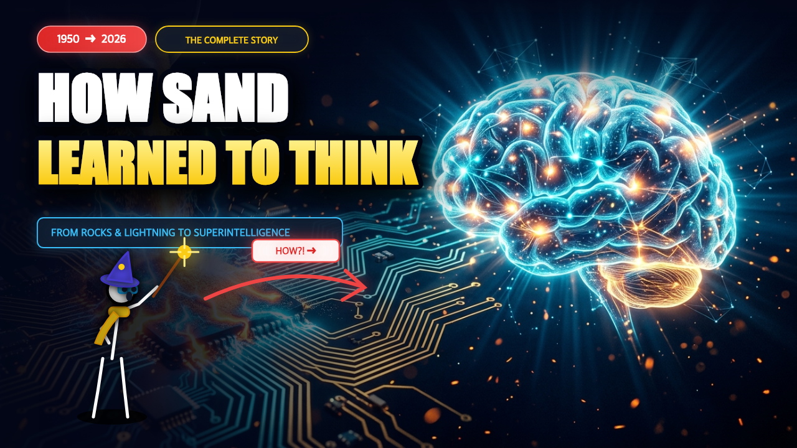

---

## 📖 TABLE OF CONTENTS

1. [Introduction: The Miracle of Thinking Sand](#introduction-the-miracle-of-thinking-sand)
2. [Chapter 1: The Beach, The Lightning & Alan Turing (1950–1956)](#chapter-1-the-beach-the-lightning--alan-turing-19501956)
   - *The Physics of Silicon*
   - *The Binary Switches (0 vs 1)*
   - *Alan Turing’s 1950 Landmark Paper*
   - *The 7 Formal Turing Variables Decoded for Kids ($Q, \Sigma, \Gamma, \delta, q_0, B, F$)*
   - *Dartmouth 1956: Coining "Artificial Intelligence"*
   - *Animation & Video Translation Blueprint*
   - *Student Exercise #1: The Turing Tape Challenge*
3. [Chapter 2: The Two Freezes & The Cookie Puzzle (1969–1973)](#chapter-2-the-two-freezes--the-cookie-puzzle-19691973)
   - *Clumsy Hardware: 1960s Mainframe vs Kitchen Toaster*
   - *The Russian Machine Translation Disaster*
   - *Marvin Minsky & The 1969 Perceptron Breakdown*
   - *The 4-Cookie XOR Puzzle: Why One Straight Ruler Fails*
   - *The 1973 Lighthill Report & The First AI Winter Freeze (-50°C)*
   - *Animation & Video Translation Blueprint*
   - *Student Exercise #2: The XOR Ruler Challenge*
4. [Chapter 3: The Video Game Secret (2006–2012)](#chapter-3-the-video-game-secret-20062012)
   - *Geoffrey Hinton’s Unshakable Faith*
   - *The Accidental Breakthrough: 3D Video Games*
   - *1 CPU Professor vs 1,000 GPU Painters*
   - *The Mathematical Morph: Video Game Pixels = Brain Cells*
   - *October 2012: Ilya Sutskever, AlexNet & ImageNet Victory*
   - *Animation & Video Translation Blueprint*
   - *Student Exercise #3: Parallel Math vs Sequential Math*
5. [Chapter 4: How AI Pays Attention (2017)](#chapter-4-how-ai-pays-attention-2017)
   - *The Robot That Forgot: The Recurrent Memory Bottleneck*
   - *2017: "Attention Is All You Need" (The 8 Google Authors)*
   - *The Tired Robot Sentence: "The robot didn't cross the street because IT was too tired"*
   - *The Mathematical Attention Laser Beam*
   - *Scaling to Modern LLMs: ChatGPT, Gemini & Code Comprehension*
   - *Animation & Video Translation Blueprint*
   - *Student Exercise #4: Trace the Attention Lasers*
6. [Chapter 5: When Machines Learned to Dream (2020–2024)](#chapter-5-when-machines-learned-to-dream-20202024)
   - *Beyond Classification: From Tagging Cats to Imagining Worlds*
   - *Forward Diffusion: Sprinkling Television Snow ($t=0 \to t=1000$)*
   - *Reverse Diffusion: Wiping Away Noise Step by Step ($t=1000 \to t=0$)*
   - *2024 Spacetime Patches: Video Generation (Sora)*
   - *Animation & Video Translation Blueprint*
   - *Student Exercise #5: The Denoising Timeline*
7. [Chapter 6: The Autonomous Horizon (2025–2026)](#chapter-6-the-autonomous-horizon-20252026)
   - *From Chatbots to Autonomous Agents*
   - *The 3-Step Agentic Feedback Loop: Plan ➔ Execute Tools ➔ Self-Correct*
   - *Real-World Autonomous Workflows: Terminal, Files & Graphics*
   - *Grand Finale: The Fire of Intelligence (1950 to 2026)*
   - *Animation & Video Translation Blueprint*
   - *Student Exercise #6: Build Your First Agent Loop*
8. [Academic Bibliography & Citation Index](#academic-bibliography--citation-index)

---

## INTRODUCTION: THE MIRACLE OF THINKING SAND

Look down at the phone in your hand or the computer screen in front of you. 

It feels like pure magic: it answers questions in fluent English, writes software, paints photorealistic artwork, and speaks with human emotion. But if you pry open the glass case and zoom down with an electron microscope, you won't find tiny biological brains or magic spells.

**Inside, every computer is fundamentally just a handful of melted sand from the beach, infused with lightning.**

How did humanity take ordinary rocks and sand, carve microscopic lines into them, trap electricity inside, and teach them how to think?

This book is the complete, definitive field guide to that 76-year adventure. Every single chapter is designed to make the deepest mathematics and computer science crystal-clear to anyone—from a curious 10-year-old child to a veteran software engineer.

Welcome to the story of Artificial Intelligence.

---

## CHAPTER 1: THE BEACH, THE LIGHTNING & ALAN TURING (1950–1956)

### 1. The Physics of Silicon
Beach sand is made of tiny quartz crystals called **silicon dioxide ($SiO_2$)**. Silicon is a very special chemical element: it is a *semiconductor*. That means it is neither a pure conductor (like copper wire, which lets electricity flow freely) nor a pure insulator (like rubber, which blocks electricity completely). 

Because silicon is in the middle, humans can control whether it allows electricity through or blocks it using a tiny control voltage.

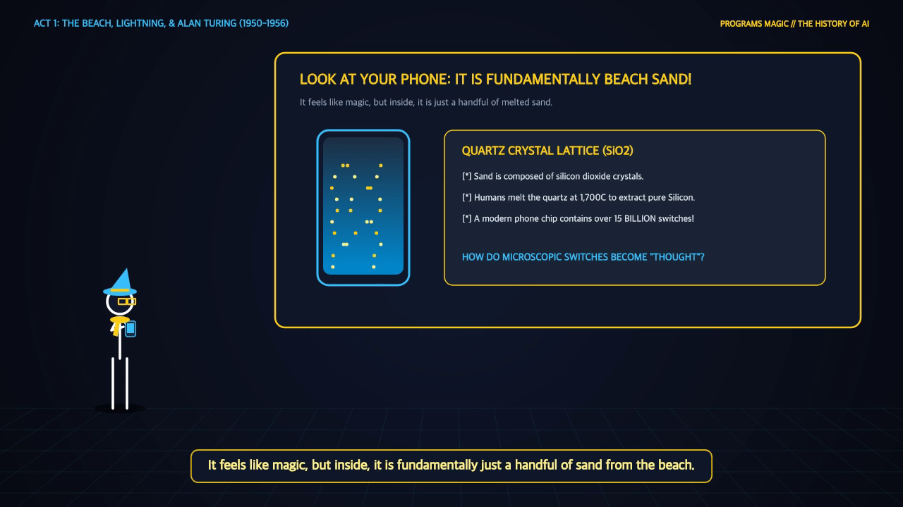

When scientists melt sand quartz at 1,700°C into pure silicon wafers, they use ultraviolet lasers to carve billions of microscopic switches into the wafer called **transistors**.

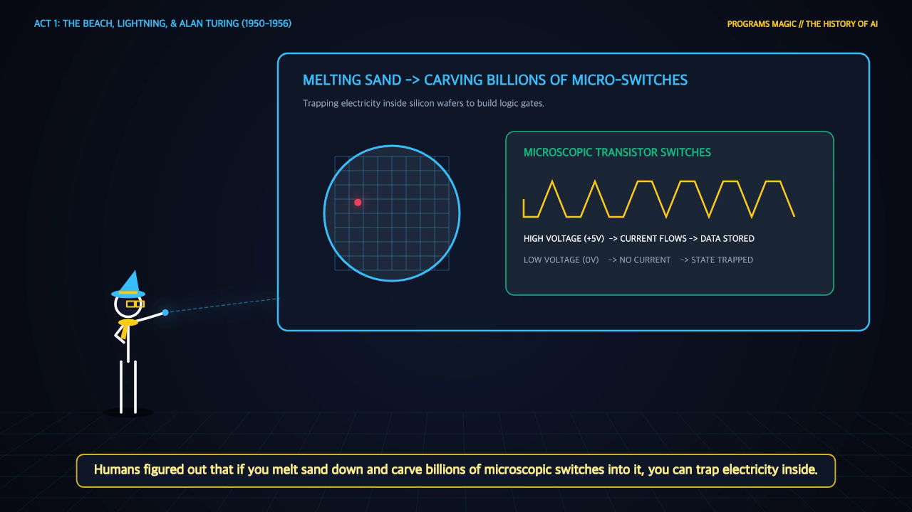

### 2. The Binary Code: Switches (0 vs 1)
Every single operation in computing boils down to two physical states:
* When a switch is **OFF**, no electricity flows $\to$ It represents the number **ZERO (0)**.
* When a switch flips **ON**, electricity flows $\to$ It represents the number **ONE (1)**.

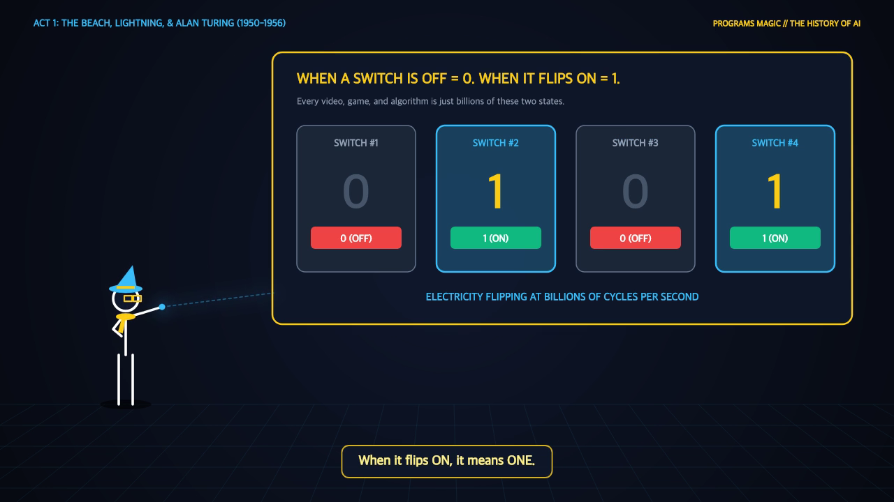

A modern smartphone processor contains over **15 billion** of these switches packed into a space smaller than your fingernail. They can flip ON and OFF billions of times every single second!

### 3. Alan Turing & The 1950 Thought Experiment
In 1950, a British mathematical genius named **Alan Turing** published a revolutionary paper in the academic journal *Mind*. He opened with seven simple words:

> *"I propose to consider the question: Can machines think?"*

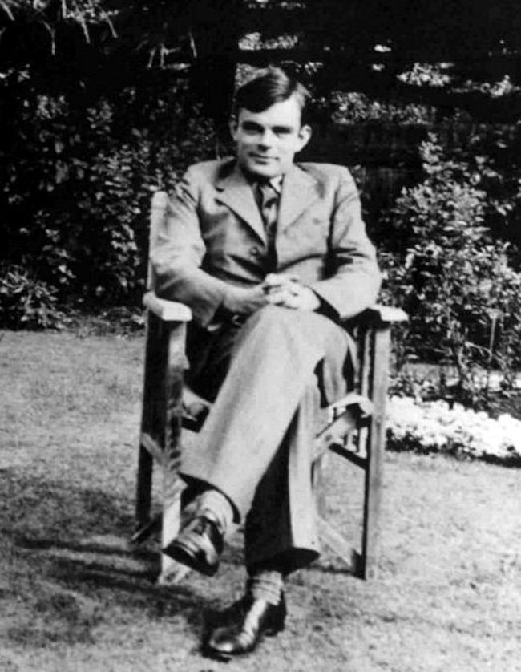

Turing did not have microchips or supercomputers in 1950. Instead, he used the power of pure imagination. He designed a theoretical machine called the **Turing Machine**:
* An **infinite paper tape** divided into squares, like a never-ending comic strip.
* A **mechanical read/write head** that hovers over one square at a time, reading symbols, writing new ones, and stepping left or right.

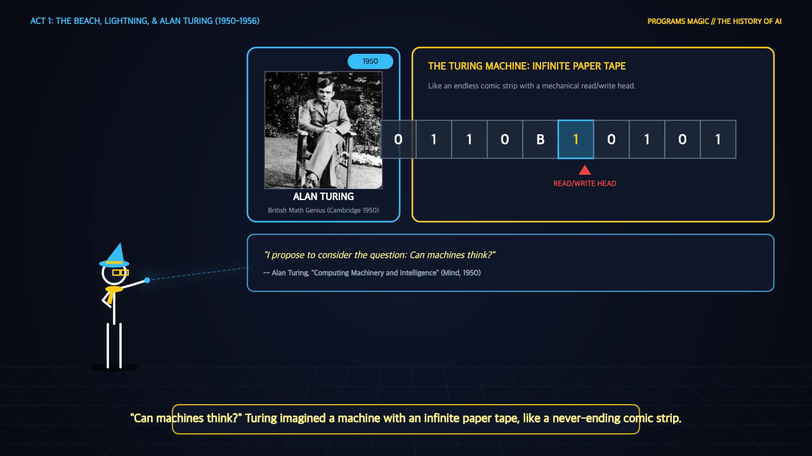

### 4. The 7 Formal Turing Variables Decoded for Kids
Turing proved mathematically that **every computer that could ever exist in the universe** only requires seven formal rules, defined as a mathematical 7-tuple:

$$\mathcal{M} = \langle Q, \Sigma, \Gamma, \delta, q_0, B, F \rangle$$

Here is what these intimidating Greek letters mean in plain English:

| Symbol | Mathematical Name | The 10-Year-Old Feynman Explanation |
| :---: | :--- | :--- |
| **$Q$** | **Finite Set of States** | **The Robot's Mood / Memory:** Is the robot reading, calculating, writing, or sleeping? |
| **$\Sigma$** | **Input Alphabet** | **The Secret Alphabet:** The basic symbols the robot understands (e.g. `{0, 1}`). |
| **$\Gamma$** | **Tape Alphabet** | **The Comic Strip Symbols:** All symbols allowed on the tape, including empty squares and math operators. |
| **$\delta$** | **Transition Function** | **The Recipe Book:** A strict list of rules: *"If you see a 1, erase it, write a 0, step right, and switch to mood Q2!"* |
| **$q_0$** | **Initial Start State** | **The Start Button:** The exact mood and position where the robot wakes up when powered on. |
| **$B$** | **Blank Symbol** | **The Blank Box:** An empty square on the paper tape waiting for a new idea or number. |
| **$F$** | **Set of Final / Halting States** | **The Finish Line:** When the puzzle is solved, the robot halts and says: *"I did it!"* |

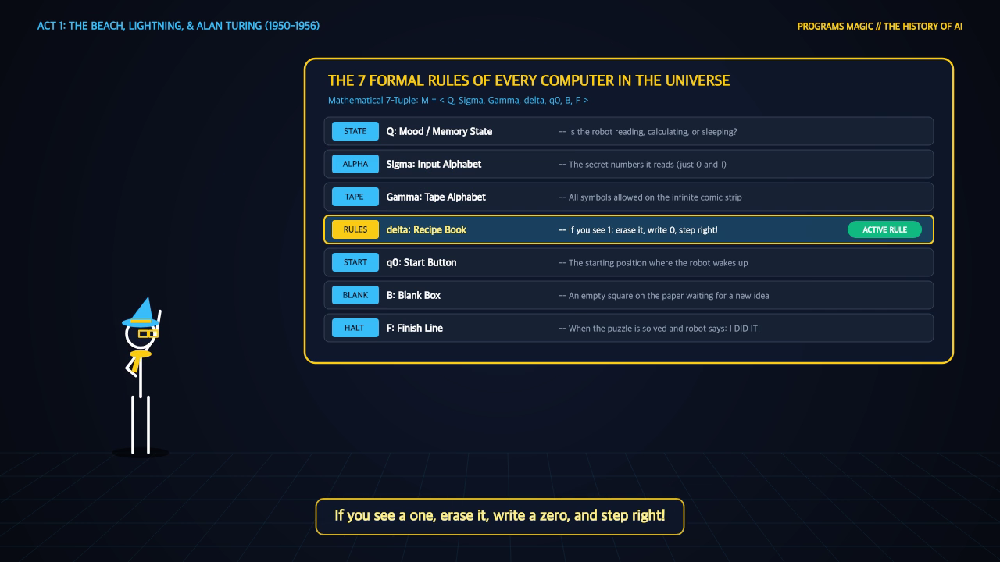

### 5. Dartmouth 1956: Coining "Artificial Intelligence"
Six years after Turing's paper, in the summer of 1956, two visionary scientists—**John McCarthy** and **Claude Shannon**—gathered with eight colleagues in an attic room at Dartmouth College in New Hampshire.

| John McCarthy (1956) | Claude Shannon (1956) |
| :---: | :---: |
| 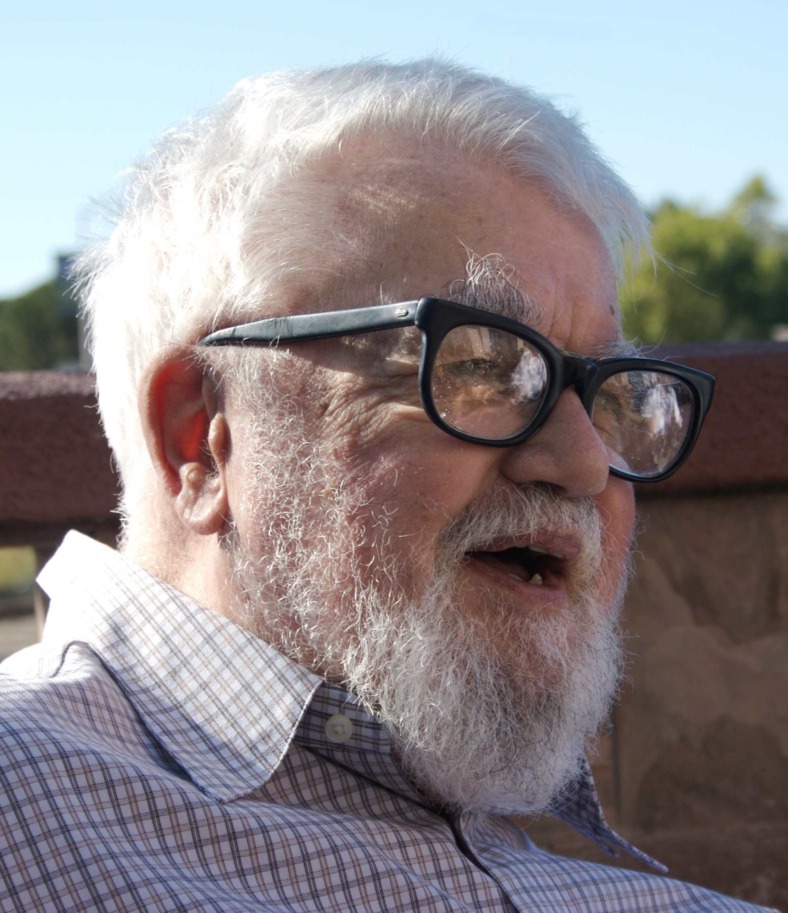 | 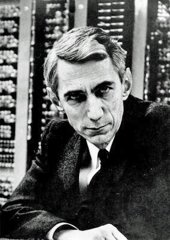 |

They wrote an audacious funding proposal to the Rockefeller Foundation: they believed that **10 scientists could solve human thinking in one single 2-month summer vacation**!

They officially gave this dream its name: **"ARTIFICIAL INTELLIGENCE"**.

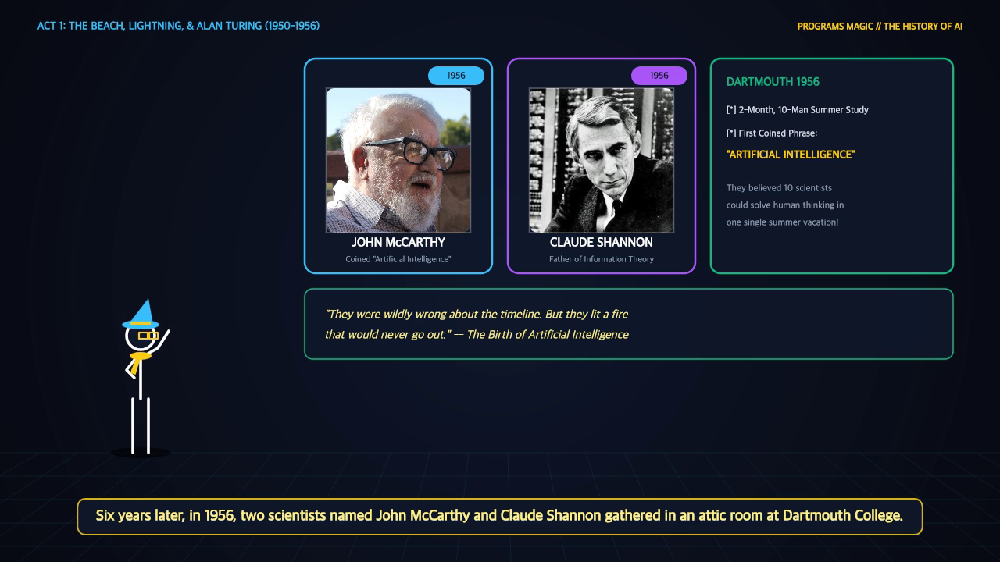

They were wildly wrong about the timeline—it would take generations of scientists, not two months—but they lit an intellectual fire that would reshape the modern world.

---

### 🎬 Video Translation Blueprint: Act 1 (0:00 – 1:44)
* **0:00 – 0:08:** Phone in Magi's hand dissolving into golden falling sand grains ($SiO_2$).
* **0:08 – 0:21:** Silicon wafer rotating with red laser beam etching micro-switches and voltage traces.
* **0:21 – 0:34:** Physical knife switches toggling with electrical sparks: OFF = 0, ON = 1.
* **0:34 – 0:49:** Cambridge 1950 badge + Turing archival portrait + rolling infinite paper tape.
* **0:49 – 1:30:** The 7 Turing variables ($Q, \Sigma, \Gamma, \delta, q_0, B, F$) highlighted sequentially with active badges.
* **1:30 – 1:44:** Dartmouth attic room with McCarthy & Shannon portraits + glowing title banner.

---

### ✏️ Student Exercise #1: The Turing Tape Challenge
Imagine a Turing Machine with the following Recipe Book ($\delta$):
1. If you are in mood $q_0$ and read `1`: Write `0`, step **RIGHT**, and stay in mood $q_0$.
2. If you are in mood $q_0$ and read `B` (Blank): Step **STAY**, and switch to mood $F$ (Finish Line).

**Question:** If the tape starts with `[ 1 ] [ 1 ] [ 1 ] [ B ]`, what will the tape look like when the machine halts at $F$?  
*Answer:* `[ 0 ] [ 0 ] [ 0 ] [ B ]`. You just built an automated binary inverter!

---

## CHAPTER 2: THE TWO FREEZES & THE COOKIE PUZZLE (1969–1973)

### 1. Clumsy Hardware: 1960s Mainframes vs A Modern Kitchen Toaster
In the 1960s, computers were massive, room-sized metal cabinets with spinning magnetic tape reels. 

Despite filling an entire room and consuming thousands of watts of power, an IBM mainframe in 1960 had only about **4 Kilobytes of RAM**. A modern smart kitchen toaster with a touch screen has **64 Megabytes of RAM**—more than **16,000 times** more memory than the machines that guided the first space missions!

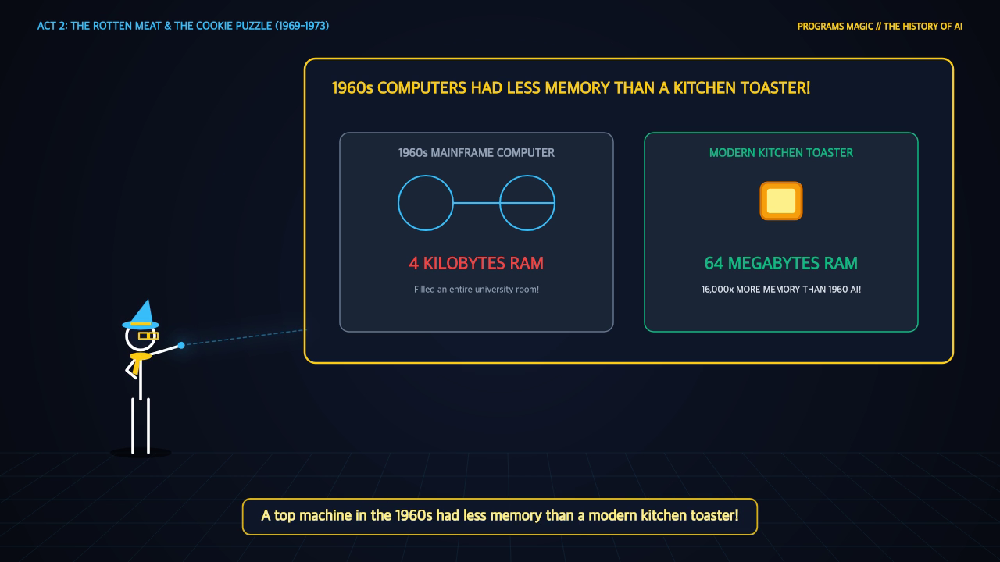

### 2. The Russian Machine Translation Disaster
During the Cold War, governments funded computers to automatically translate Russian military documents into English.

Scientists fed the famous biblical proverb into the computer:
> *"The spirit is willing, but the flesh is weak."*  
> *(Meaning: Your mind wants to do your chores, but your physical body is too sleepy).*

The computer had zero real-world understanding or feelings. It looked up words mechanically in a dictionary and spat out:
> **"THE VODKA IS GOOD, BUT THE MEAT IS ROTTEN!" 🍾🥩**

Because "spirit" was translated as alcohol (vodka) and "flesh" as butcher meat, the sentence was total gibberish! It proved that early computers were just calculating numbers without any understanding of context.

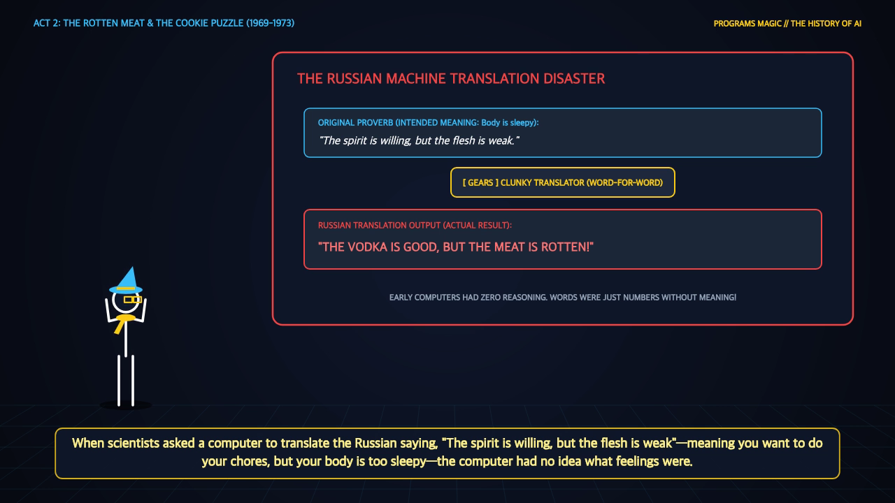

### 3. Marvin Minsky & The 1969 Perceptron Proof
In 1969, **Marvin Minsky** (co-founder of the MIT AI Lab) and Seymour Papert published a devastating mathematical book called *"Perceptrons"*.

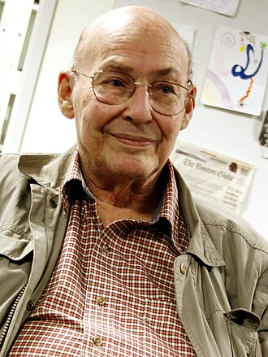

They analyzed single-layer artificial neurons (perceptrons) and proved mathematically that they could not even solve a basic child's logic puzzle called **XOR (Exclusive OR)**.

### 4. The 4-Cookie XOR Puzzle: Why One Straight Ruler Fails
Imagine four cookies sitting on a table in front of you:

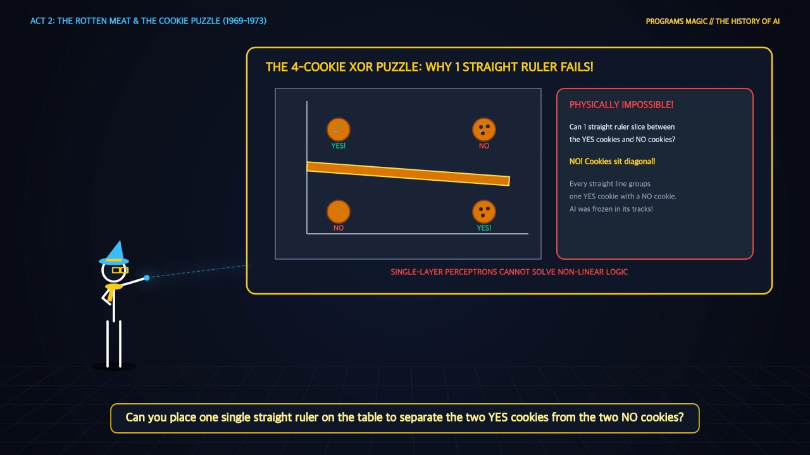

1. **Cookie #1 (0, 0): Plain dough** $\to$ Answer: **NO ❌**
2. **Cookie #2 (1, 1): Chocolate chips AND rainbow sprinkles** $\to$ Answer: **NO ❌**
3. **Cookie #3 (1, 0): ONLY chocolate chips** $\to$ Answer: **YES! ⭐**
4. **Cookie #4 (0, 1): ONLY rainbow sprinkles** $\to$ Answer: **YES! ⭐**

Now, take a single straight wooden ruler. **Can you place that straight ruler on the table to cleanly separate the two YES cookies from the two NO cookies?**

* Try placing it horizontally $\to$ Fails! (Groups a YES with a NO).
* Try placing it vertically $\to$ Fails! (Groups a YES with a NO).
* Try placing it diagonally $\to$ Fails! (Cuts off one of the YES cookies).

It is **physically and mathematically impossible**! Because single-layer artificial neurons could only draw one straight line (a linear decision boundary), they completely broke down on non-linear problems.

### 5. The 1973 Lighthill Report & The First AI Winter Freeze
In 1973, **Sir James Lighthill** submitted a crushing report to the UK Science Research Council stating that artificial intelligence had failed to achieve common sense or translation.

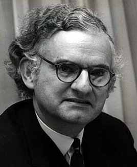

Governments immediately froze funding:
* US and UK funding plummeted from **100% down to 15%**.
* Laboratories were shut down, and researchers were fired.
* The field entered the brutal **First AI Winter (-50°C)**.

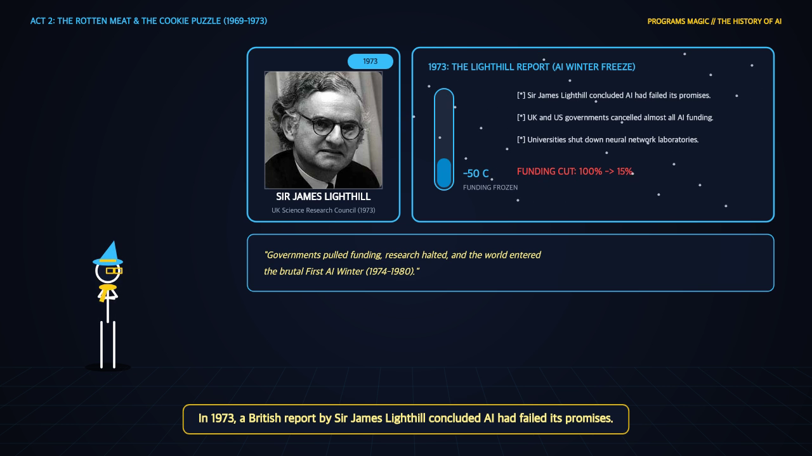

---

### 🎬 Video Translation Blueprint: Act 2 (1:44 – 3:03)
* **1:44 – 1:55:** Side-by-side 1960s IBM computer room vs glowing modern kitchen toaster memory meters.
* **1:55 – 2:20:** Mechanical language translation gear machine emitting smoke and dispensing a bottle of Vodka and green Rotten Meat.
* **2:20 – 2:35:** Marvin Minsky portrait + *"Perceptrons"* book badge.
* **2:35 – 2:55:** 2D Cartesian cookie plane with animated wooden ruler rotating and failing to slice diagonal cookies.
* **2:55 – 3:03:** Sir James Lighthill portrait + dropping mercury thermometer (-50°C) with falling snow and shivering Magi.

---

### ✏️ Student Exercise #2: The XOR Ruler Challenge
Draw a square on a sheet of paper with four corners:
* Bottom-left $(0,0)$: Draw a red circle (NO).
* Top-right $(1,1)$: Draw a red circle (NO).
* Bottom-right $(1,0)$: Draw a gold star (YES).
* Top-left $(0,1)$: Draw a gold star (YES).

**Challenge:** Try drawing ONE straight pencil line through the square that leaves both gold stars on one side and both red circles on the other side.  
**Discovery:** Notice why you need a curved line, or TWO rulers (a hidden layer!) to solve it!

---

## CHAPTER 3: THE VIDEO GAME SECRET (2006–2012)

### 1. Geoffrey Hinton's Persistence
Through decades of skepticism and lack of funding, a stubborn British-Canadian cognitive scientist named **Geoffrey Hinton** refused to abandon neural networks.

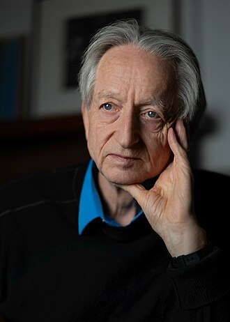

Hinton realized that neural networks were never broken. They simply lacked two things:
1. **Millions of real-world training examples** (digital cameras and the internet solved this).
2. **Chips that could calculate thousands of equations simultaneously**.

### 2. The Accidental Discovery: 3D Video Games
To render a 3D video game on a computer monitor, a graphics card must color **2,073,600 pixels** (for a standard 1080p display) **60 times every single second**!

Every single pixel requires mathematical matrix multiplication to determine lighting, shadows, and reflections.

### 3. 1 CPU Professor vs 1,000 GPU Painters
To understand why graphic cards (GPUs) changed AI forever, use this physical metaphor:

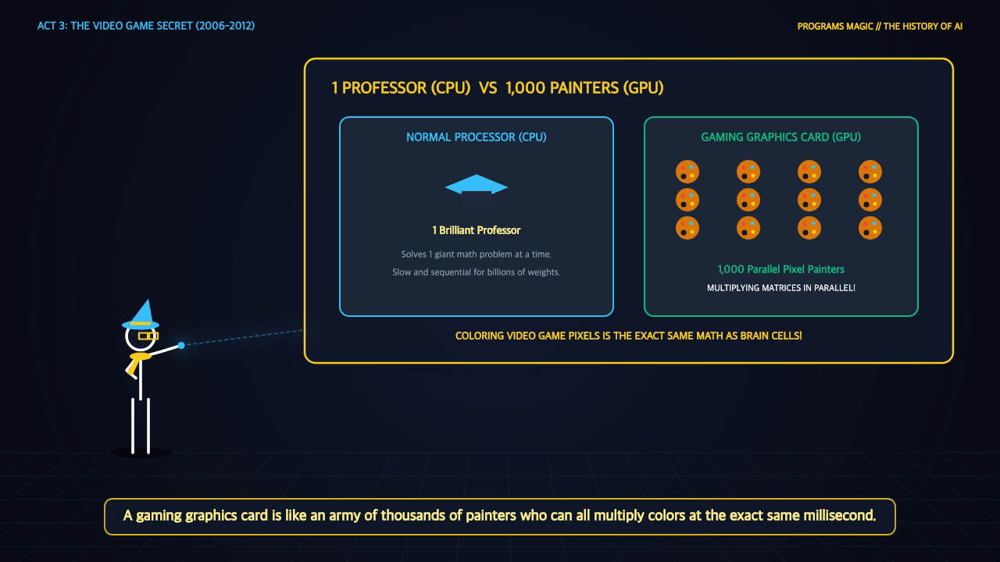

* **The CPU (Central Processing Unit) is like 1 Genius Math Professor:**  
  He can solve extraordinarily complicated math equations, but he can only solve **one equation at a time**.
* **The GPU (Graphics Processing Unit) is like an Army of 1,000 Pixel Painters:**  
  Each painter only knows how to do simple addition and multiplication, but **all 1,000 painters work at the exact same millisecond in parallel**!

### 4. The Math Morph: Video Game Pixels = Brain Cells
Hinton made an astonishing connection:  
Calculating the lighting on a polygon in a video game uses the **exact same matrix math** ($C = A \times B$) as calculating the synaptic signals passing between artificial brain cells!

### 5. October 2012: Ilya Sutskever, AlexNet & ImageNet
In October 2012, Hinton and his brilliant graduate students **Alex Krizhevsky** and **Ilya Sutskever** built an 8-layer deep convolutional neural network called **AlexNet**, trained on two commercial gaming graphics cards (NVIDIA GeForce GTX 580).


They entered the global **ImageNet challenge** (identifying 1.2 million photos across 1,000 categories).

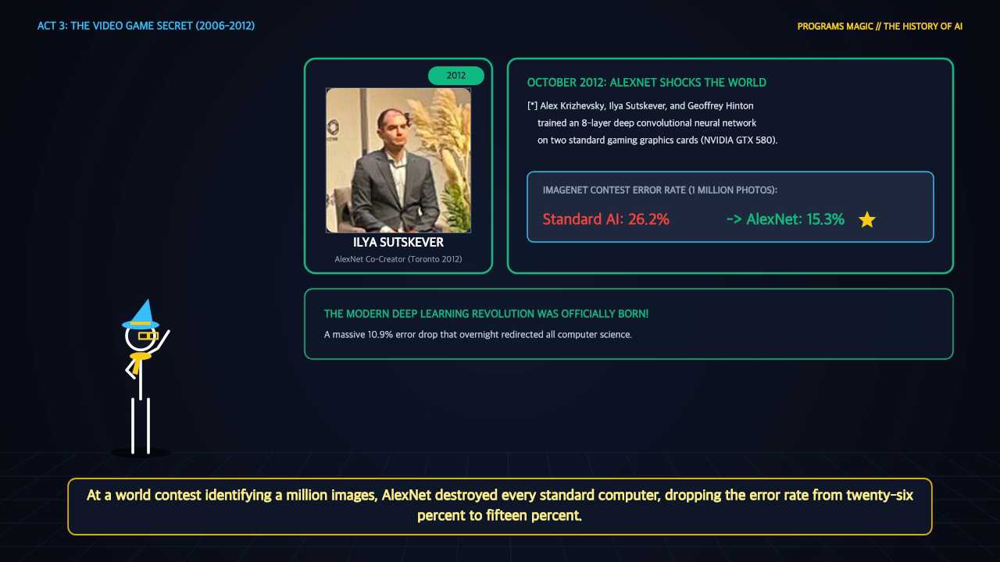

* Standard computer science algorithms achieved an error rate of **26.2%**.
* AlexNet crushed the competition with an error rate of **15.3%**—a massive **10.9% drop** in a single year!

The modern Deep Learning Revolution was officially born.

---

### 🎬 Video Translation Blueprint: Act 3 (3:03 – 4:17)
* **3:03 – 3:25:** Geoffrey Hinton archival portrait + stream of real-world photos flowing into deep layers.
* **3:25 – 3:42:** 3D wireframe video game rendering at 60 FPS with pixel count HUD.
* **3:42 – 4:05:** Split-screen: 1 math professor in graduation cap vs grid of 1,000 pixel painters painting simultaneously.
* **4:05 – 4:17:** Ilya Sutskever portrait + AlexNet CNN feature filters + ImageNet error scoreboard drop from 26.2% to 15.3%.

---

## CHAPTER 4: HOW AI PAYS ATTENTION (2017)

### 1. The Robot That Forgot (Recurrent Bottlenecks)
Before 2017, artificial intelligence processed human language using Recurrent Neural Networks (RNNs) and LSTMs. They read text just like humans: **word... by... word**.

The fatal flaw: by the time an RNN reached the end of a 50-word sentence, its internal memory vector had compressed the earlier words so much that it **forgot the beginning of the sentence**!

### 2. 2017: "Attention Is All You Need" (The 8 Authors)
In June 2017, eight researchers at Google Brain published a landmark paper with an audacious title: **"Attention Is All You Need"**.

They invented the **Transformer architecture**. Instead of reading sequentially, a Transformer ingests an entire document at once, allowing every single word to look at every other word simultaneously.

### 3. The Tired Robot Sentence
Consider this simple English sentence:

> *"The robot didn't cross the street because **IT** was too tired."*

**Question:** Who was tired? The street? Or the robot?

A 10-year-old child instantly knows that the **robot** was tired because streets are made of asphalt and don't experience physical fatigue. But how does a mathematical computer know what the word `"IT"` refers to?

### 4. The Mathematical Attention Laser Beam
The Transformer solves this using a mathematical formula called **Scaled Dot-Product Attention**:

$$\text{Attention}(Q, K, V) = \text{softmax}\left(\frac{QK^T}{\sqrt{d_k}}\right)V$$

The word `"IT"` emits mathematical queries ($Q$) to every other word in the sentence:
* Query from `"IT"` to `"street"` $\to$ Attention Weight: **0.04** (Very weak connection).
* Query from `"IT"` to `"cross"` $\to$ Attention Weight: **0.08** (Weak connection).
* Query from `"IT"` to `"robot"` $\to$ **Attention Weight: 0.94 ⭐ (Blazing bright laser connection!)**

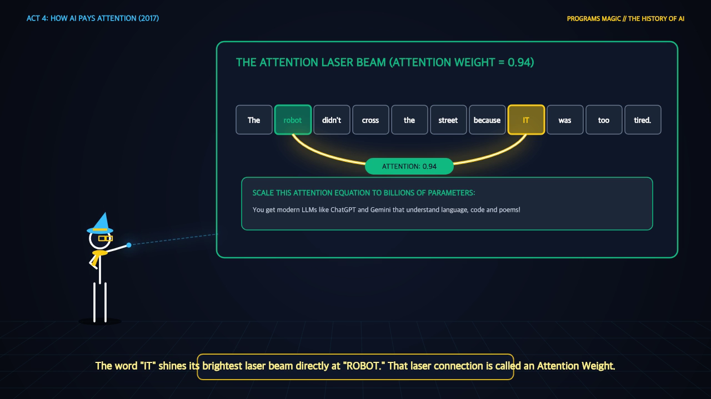

Because the attention weight between `"IT"` and `"robot"` is 0.94, the computer understands the exact meaning of the sentence!

### 5. Scaling to Modern LLMs: ChatGPT & Gemini
When you scale this attention equation across hundreds of billions of words and thousands of GPU clusters, you get Large Language Models (LLMs) like ChatGPT, Claude, and Gemini that can write code, debug complex systems, draft essays, and pass professional exams.

---

### 🎬 Video Translation Blueprint: Act 4 (4:17 – 5:22)
* **4:17 – 4:30:** Clumsy robot reading word blocks on a conveyor belt with early words evaporating into question marks.
* **4:30 – 4:45:** NeurIPS 2017 paper badge + 8 Google Brain authors list.
* **4:45 – 5:08:** Giant sentence blocks on screen: *"The robot didn't cross the street because IT was too tired."*
* **5:08 – 5:22:** A radiant golden-cyan laser beam fires from `"IT"` directly to `"robot"` with an Attention Weight of 0.94.

---

## CHAPTER 5: WHEN MACHINES LEARNED TO DREAM (2020–2024)

### 1. Beyond Classification: Imagining Worlds
For 70 years, artificial intelligence was primarily *discriminative*: you gave it an image, and it told you if it was a cat or a dog.

In 2020, researchers figured out how to make computers *generative* using a physics-inspired process called **Denoising Diffusion Probabilistic Models (DDPM)**.

### 2. Forward Diffusion: Sprinkling Television Snow
Imagine taking a crystal-clear, photorealistic photograph of a mountain sunrise.

In forward diffusion, the computer slowly adds tiny flecks of Gaussian noise (random static) to the photo over 1,000 discrete steps:
* At step $t = 0$: Crisp 4K photo.
* At step $t = 250$: Faint static grain appears.
* At step $t = 500$: Details dissolve into fuzzy shapes.
* At step $t = 1000$: The image is 100% pure television static snow!

### 3. Reverse Diffusion: The Neural Denoising Wand
Scientists then trained a neural network (typically a U-Net or Diffusion Transformer) to do the exact opposite: **predict and subtract the noise at each step**.

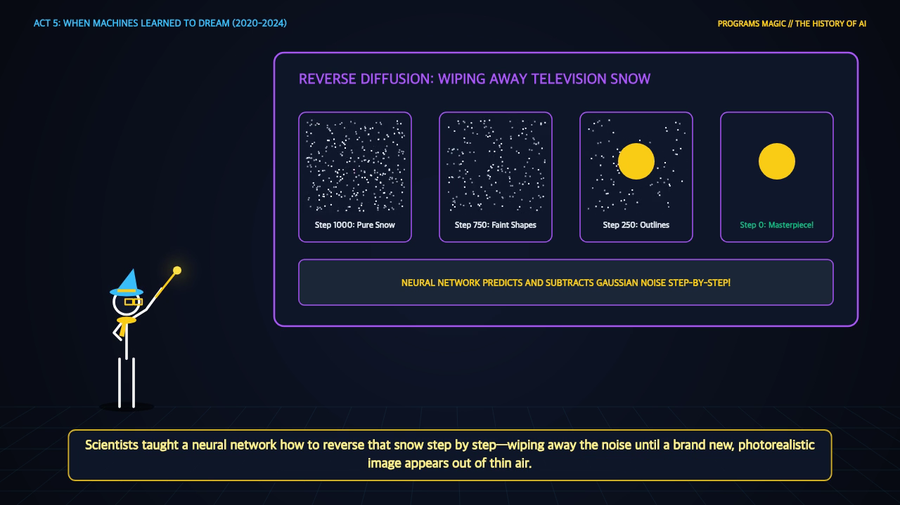

When you type a prompt like *"A magical wizard standing on a glowing mountain at dusk"*, the AI starts with pure random noise and wipes away the static step-by-step until a brand-new, original painting emerges out of thin air!

### 4. 2024 Spacetime Patches: Video Generation (Sora)
By 2024, diffusion merged with Transformers to generate full-motion video. Instead of treating video as flat 2D frames, models chop video into **3D spacetime patches**, learning the laws of physics, light reflection, fluid dynamics, and gravity in digital space.

---

### 🎬 Video Translation Blueprint: Act 5 (5:22 – 6:09)
* **5:22 – 5:35:** Vintage CRT television showing an AI dreaming glowing bubbles of art.
* **5:35 – 5:50:** Mountain photo slowly covered in fluttering white noise particles until pure static.
* **5:50 – 6:05:** Neural network denoising wand wiping away static step-by-step to reveal a 4K masterpiece.
* **6:05 – 6:09:** 3D spacetime video patches simulating water ripples and reflections.

---

## CHAPTER 6: THE AUTONOMOUS HORIZON (2025–2026)

### 1. Beyond Chatbots: From Words to Action
A standard chatbot is passive: you ask it a question, and it gives you a paragraph of text. It cannot do anything on its own.

In 2025 and 2026, the frontier shifted to **Autonomous AI Agents**: software that doesn't just talk, but takes real-world action to solve complex engineering goals.

### 2. The 3-Step Agentic Feedback Loop
True agentic intelligence operates in an active feedback loop:

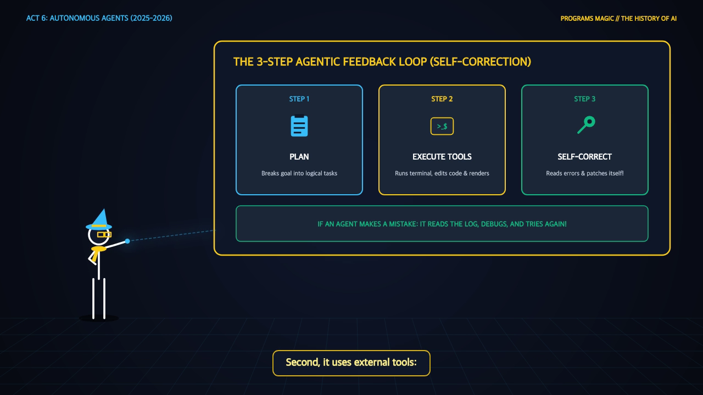

```
        ┌───────────────────────────────────┐
        │        1. PLAN (Decompose)        │
        │   Break high-level goal into      │
        │   discrete, verifiable tasks      │
        └─────────────────┬─────────────────┘
                          │
                          ▼
        ┌───────────────────────────────────┐
        │     2. EXECUTE TOOLS (Act)        │
        │   Run shell terminal commands,    │
        │   edit code, query APIs, render   │
        └─────────────────┬─────────────────┘
                          │
                          ▼
        ┌───────────────────────────────────┐
        │    3. SELF-CORRECTION (Verify)    │
        │   If error occurs: read trace,    │
        │   patch code, and try again!      │
        └─────────────────┬─────────────────┘
                          │
                          └───► SUCCESS!
```

1. **PLAN:** The agent analyzes the goal, breaks it into logical steps, and creates a plan.
2. **TOOL EXECUTION:** The agent executes tools in a real environment—running terminal commands, creating files, writing code, and compiling binaries.
3. **SELF-CORRECTION:** If a test fails or a compiler produces an error, the agent doesn't panic or stop: it reads the error log, inspects the stack trace, fixes its own code, and re-executes until the goal succeeds!

### 3. Grand Finale: The Fire of Intelligence
From Alan Turing sitting at Cambridge in 1950 with an imaginary roll of paper tape, through the freezing winters of 1973, the GPU gaming discovery, and Transformers, to modern autonomous agents directing complete documentaries in 2026:

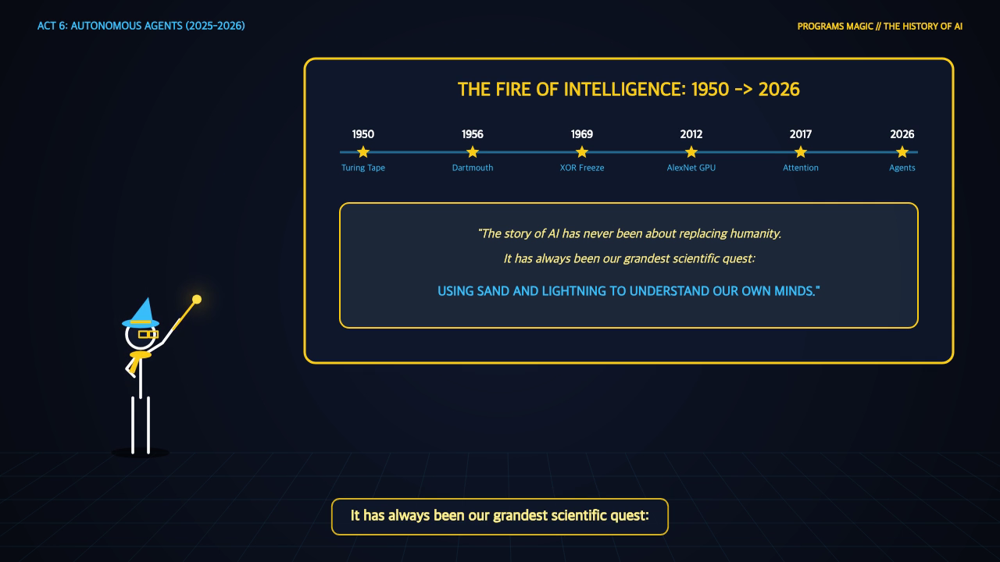

> *"The story of AI has never been about replacing humanity. It has always been our grandest scientific quest: using sand and lightning to understand the miracle of how our own minds work."*

---

## ACADEMIC BIBLIOGRAPHY & CITATION INDEX

1. **Turing, A. M. (1950).** *"Computing Machinery and Intelligence."* *Mind*, 59(236), 433–460.
2. **McCarthy, J., Minsky, M. L., Rochester, N., & Shannon, C. E. (1955).** *"A Proposal for the Dartmouth Summer Research Project on Artificial Intelligence."* Dartmouth College.
3. **Minsky, M., & Papert, S. (1969).** *"Perceptrons: An Introduction to Computational Geometry."* MIT Press, Cambridge, MA.
4. **Lighthill, J. (1973).** *"Artificial Intelligence: A General Survey."* Science Research Council, London.
5. **Krizhevsky, A., Sutskever, I., & Hinton, G. E. (2012).** *"ImageNet Classification with Deep Convolutional Neural Networks."* *Advances in Neural Information Processing Systems (NeurIPS)*, 25, 1097–1105.
6. **Vaswani, A., Shazeer, N., Parmar, N., Uszkoreit, J., Jones, L., Gomez, A. N., Kaiser, Ł., & Polosukhin, I. (2017).** *"Attention Is All You Need."* *Advances in Neural Information Processing Systems (NeurIPS)*, 30.
7. **Ho, J., Jain, A., & Abbeel, P. (2020).** *"Denoising Diffusion Probabilistic Models."* *Advances in Neural Information Processing Systems (NeurIPS)*, 33, 6840–6851.

---

*© 2026 Programs Magic. All Rights Reserved. Produced for the YouTube flagship series.*

