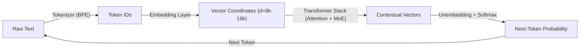

# Comprehensive Technical Research Brief: "How AI Actually Works"
**Document**: Technical Fact-Check, Architectural Specs, and Animation Mechanics  
**Episode**: Episode 02 (Upgraded from EP08 Masterpiece)  
**Target Audience**: General Public (Zero ML background, 12-year-old intuitive Feynman/3Blue1Brown standard)  
**Author**: AI Technical Research Specialist (@researcher)

---

## 1. Executive Summary & Core Conceptual Map

Modern Large Language Models (LLMs) appear like magical, omniscient minds, but mechanistically they are massive feedforward computational graphs performing three fundamental transformations:
1. **Symbolic to Continuous Space**: Text $\to$ Subword Tokens $\to$ High-Dimensional Vector Embeddings ($\mathbb{R}^d$).
2. **Contextual Transformation**: Tokens exchange information through Multi-Head Attention ($Q, K, V$) and Feedforward Networks (Dense or Sparse MoE) across 32–128 layers.
3. **Probability Projection**: Final vectors project through an unembedding matrix to a Softmax probability distribution over the vocabulary to sample the next token.

Recent breakthroughs have evolved AI from single-pass auto-regressive predictors into **Reasoning Models** (spending inference-time compute in hidden chains of thought) and **Autonomous Agents** (running in iterative ReAct loops with tools and environment feedback).

---

## 2. Topic Deep-Dive & Fact-Checking

### Section 1: Tokenization (The Symbolic Barrier)
* **How LLMs "Read"**: Computers cannot ingest raw text. They process fixed integer IDs.
* **Algorithms**:
  - **BPE (Byte-Pair Encoding)**: Originally a data compression algorithm (Gage, 1994), adapted for NLP by Sennrich et al. (2016). Starts with individual characters/bytes and iteratively merges the most frequent adjacent pairs. Used in GPT-2, GPT-3, GPT-4, Llama 3, DeepSeek.
  - **SentencePiece (Kudo & Richardson, 2018)**: Treats the entire input stream as raw Unicode characters (including whitespace denoted as `_`), implementing BPE or Unigram language models without language-dependent pre-tokenization. Used in Llama 1/2, Gemma, T5.
* **Token vs. Word Statistics**:
  - 1 token $\approx$ 0.75 words in standard English (Rule of thumb: 1,000 tokens $\approx$ 750 words).
  - Average token length in English is $\approx 4$ characters or $\approx 1.33$ tokens per word.
  - For non-English languages (Hindi, Arabic, Chinese) or code, older tokenizers had terrible token efficiency (taking 3–10 tokens per word). Modern tokenizers expanded vocabularies to fix this "token tax."
* **Vocabulary Sizes Across Modern Models**:
  - **GPT-2 / GPT-3**: 50,257 tokens (`r50k` / `p50k`).
  - **GPT-4 / GPT-4 Turbo**: 100,277 tokens (`cl100k_base`).
  - **GPT-4o / GPT-4o-mini**: 199,998 tokens (`o200k_base`) — expanded significantly for multilingual & code compression.
  - **Llama 2**: 32,000 tokens.
  - **Llama 3 / 3.1 / 3.3**: 128,256 tokens (tiktoken-based BPE).
  - **DeepSeek-V3 / DeepSeek-R1**: 129,280 tokens (Byte-level BPE).
  - **Google Gemma 1/2**: 256,000 tokens.
* **The "Strawberry" / "r" Counting Failure (Verified Breakdown)**:
  - *The Trap*: When asked "How many 'r's are in strawberry?", early GPT-4 and Claude 3 insisted "2".
  - *Root Cause*: The model **never sees characters**! It only sees discrete token IDs.
  - In `cl100k_base`:
    - `"strawberry"` $\to$ `['str', 'aw', 'berry']` (3 tokens: IDs `[496, 675, 15717]`).
    - `" strawberry"` (with leading space) $\to$ `[73700]` (**one single indivisible token**!).
  - In `o200k_base`:
    - `"strawberry"` $\to$ `['st', 'raw', 'berry']` (3 tokens: IDs `[302, 1618, 19772]`).
    - `" strawberry"` $\to$ `[101830]` (**one single token**!).
  - To the transformer, `" strawberry"` is an opaque symbol (like barcode #73700). Unless it generates intermediate reasoning tokens that explicitly unpack the spelling (`s-t-r-a-w-b-e-r-r-y`), it must rely on statistical co-occurrence, which confuses the ending `"berry"` (which has 2 'r's) with the whole word!

---

### Section 2: Embeddings & Vector Spaces
* **What is a Word/Token Embedding?**: A dense vector representation in continuous vector space ($\mathbb{R}^d$) where semantically similar tokens reside near each other (measured via cosine similarity or dot product).
* **Dimensions ($d_{\text{model}}$) in Real Frontier Models**:
  - **Word2Vec (2013)**: 300 dimensions.
  - **BERT-base (2018)**: 768 dimensions.
  - **GPT-2 Small**: 768 dims; **GPT-2 XL**: 1,600 dims.
  - **GPT-3 (175B)**: 12,288 dimensions (96 layers, 96 heads).
  - **Llama 2 / Llama 3 8B**: 4,096 dimensions.
  - **Llama 3 70B**: 8,192 dimensions.
  - **Llama 3 405B**: 16,384 dimensions!
  - **DeepSeek-V3 / R1**: 7,168 dimensions.
* **The "King - Man + Woman = Queen" Analogy: Fact vs. Myth**:
  - *Origin*: Mikolov et al. (2013) introduced Word2Vec showing that vector differences roughly captured syntactic and semantic relationships: $\vec{v}_{\text{King}} - \vec{v}_{\text{Man}} + \vec{v}_{\text{Woman}} \approx \vec{v}_{\text{Queen}}$.
  - *The YouTube Myth*: YouTube videos describe this as an exact mathematical equation that proves the neural network understands human logic and ontology.
  - *The Reality & Flaws (What to Flag)*:
    1. **Self-Nearest Neighbor Exclusion**: In the original implementations, when calculating the nearest neighbor to $\vec{v}_{\text{King}} - \vec{v}_{\text{Man}} + \vec{v}_{\text{Woman}}$, the algorithm **explicitly had to ban the input words** (`King`, `Man`, `Woman`). If you don't ban them, the closest vector to the result is often `King` itself!
    2. **Anisotropy (The "Cone Effect")**: High-dimensional embedding spaces are heavily anisotropic—vectors are not distributed evenly across the sphere, but cluster tightly inside a narrow high-dimensional cone. Non-informative and high-frequency tokens skew space, making linear analogies an artifact of geometric distortion rather than deep reasoning.
    3. **Static vs. Contextual Embeddings**: Word2Vec gave "bank" a single static vector. Modern transformers discard static representations after Layer 0: every layer updates the vector based on surrounding context. In modern LLMs, "bank" in "river bank" ends up in a completely different sector of high-dimensional space than "bank" in "investment bank."

---

### Section 3: The Attention Mechanism (Transformers)
* **Foundational Paper**: *"Attention Is All You Need"* (Vaswani et al., Google Brain & Google Research, June 2017 - NeurIPS 2017).
* **Core Equation**:
  $$\text{Attention}(Q, K, V) = \text{softmax}\left(\frac{Q K^T}{\sqrt{d_k}}\right) V$$
* **Query, Key, Value Explained Simply (Feynman Style)**:
  - **Query ($Q$)**: The question / search term. *"I am a verb ('ate'), who is my subject, and what did I eat?"*
  - **Key ($K$)**: The label / index on the file cabinet. *"I am 'The boy' (noun, subject)"* or *"I am 'an apple' (noun, direct object)"*.
  - **Value ($V$)**: The actual information payload transferred if a match is made.
  - **Dot Product ($Q \cdot K^T$)**: Measuring compatibility/similarity between what is sought and what is offered.
  - **Scale Factor ($\frac{1}{\sqrt{d_k}}$)**: In high dimensions (e.g., $d_k = 128$), dot products grow large in magnitude, pushing the softmax function into regions with near-zero gradients (the vanishing gradient problem). Dividing by $\sqrt{d_k}$ stabilizes variance to 1.
  - **Softmax**: Converts raw match scores into a clean probability distribution summing to 1.0 (100% of the attention budget distributed among all words).
* **Multi-Head Attention (MHA)**:
  - Instead of one set of $Q, K, V$, the model splits dimensions across $h$ independent heads.
  - Allows the model to attend to information at different positions from different representation subspaces simultaneously (e.g., Head 1 tracks grammar/verb-agreement, Head 2 tracks pronoun coreference, Head 3 tracks punctuation/delimiters, Head 4 tracks spatial relationships).
* **Real-World Head Counts**:
  - **Vaswani (2017)**: 8 heads.
  - **GPT-3**: 96 heads (head dimension 128).
  - **Llama 3 8B**: 32 query heads, 8 KV heads (Grouped-Query Attention).
  - **Llama 3 70B**: 64 query heads, 8 KV heads.
  - **Llama 3 405B**: 128 query heads, 16 KV heads.
* **Why Attention is $O(N^2)$ Quadratically Expensive**:
  - In a sequence of length $N$, every single token must compute an attention score with every other token. The full attention matrix is $N \times N$.
  - Doubling context from 4,000 to 8,000 tokens quadruples computations ($4\times$).
  - Scaling to 128,000 tokens ($32\times$ length) requires **$1,024\times$** the attention matrix memory and operations!
  - *Engineering Solutions*: **FlashAttention** (Dao et al., 2022/2023 - tiling matrix multiplication inside fast GPU SRAM to avoid memory bandwidth bottlenecks), **GQA (Grouped-Query Attention)**, and **MLA (Multi-head Latent Attention)** in DeepSeek.

---

### Section 4: Reasoning Models & Test-Time Compute
* **The Origin of Chain-of-Thought**:
  - *Paper*: *"Chain-of-Thought Prompting Elicits Reasoning in Large Language Models"* (Jason Wei et al., Google Research, Jan 2022).
  - Showing prompt examples with intermediate reasoning steps ("Let's think step by step") dramatically improved arithmetic, commonsense, and symbolic reasoning.
* **Why Normal LLMs Cannot "Think" Without Tokens**:
  - **Fixed Computational Depth**: A standard autoregressive transformer is a fixed-depth feedforward circuit ($L$ layers). Generating 1 token takes a fixed, constant number of FLOPs ($\approx 2 \times P$ operations, where $P$ is parameter count).
  - It has no internal looping mechanism or dynamic clock cycle! If you ask a 175B model "What is $2+2$?" or "Prove the Riemann Hypothesis", it spends the **exact same number of FLOPs** before printing the first token.
  - **Thinking Tokens**: Emitting intermediate reasoning tokens allows the model to execute sequential computation. 1,000 thinking tokens = $1,000 \times L$ layers of deep mathematical transformation before committing to a user-facing answer!
* **OpenAI o1 / o3 Mechanics**:
  - Trained via large-scale Reinforcement Learning (RL) directly on reasoning chains.
  - **Outcome Reward Models (ORM)** vs. **Process Reward Models (PRM)**:
    - *ORM*: Scores only the final answer (0 or 1). Can suffer from false positives (getting right answer by flawed logic).
    - *PRM*: Scores every individual intermediate reasoning step ("Let's Verify Step by Step", Lightman et al., OpenAI 2023). Guides the model along verified paths.
  - Test-time search: Uses inference-time compute scaling (sampling, tree-search exploration, backtracking).
* **DeepSeek-R1 & GRPO (The January 2025 Open-Source Revolution)**:
  - *Paper*: *"DeepSeek-R1: Incentivizing Reasoning Capability in LLMs via Reinforcement Learning"* (DeepSeek, Jan 2025).
  - **GRPO (Group Relative Policy Optimization)**:
    - Traditional PPO requires four models in GPU memory: Actor (policy), Critic (value function), Reference Model, and Reward Model. The Critic model is massive (often as large as the Actor), doubling training VRAM!
    - GRPO **eliminates the Critic model entirely**!
    - *Mechanics*: For each prompt, the policy generates a group of $G$ candidate outputs ($o_1, \dots, o_G$). It evaluates rewards $(r_1, \dots, r_G)$ using rule-based verifiers (math ground truth, compiler execution).
    - It computes the mean $\mu$ and standard deviation $\sigma$ of the group's rewards and normalizes:
      $$A_i = \frac{r_i - \mu}{\sigma}$$
    - Responses that beat the group average get positive advantages; those below average get negative updates.
  - **DeepSeek-R1-Zero Emergent Behavior**:
    - Trained with pure RL without human supervised fine-tuning (SFT).
    - Spontaneously developed internal self-reflection, checking work, and backtracking: *"Wait, wait, let me re-evaluate this equation... Ah, that's wrong, let me try another method."* (The documented "Aha moment").

---

### Section 5: Mixture of Experts (MoE) Architecture
* **Dense vs. Sparse Models**:
  - In a standard **dense model** (like Llama 3 70B), every single parameter/weight is activated for every single token processed.
  - In a **sparse MoE model**, the dense Feed-Forward Network (FFN) layers are split into many smaller parallel subnetworks ("experts"). A lightweight gating router dynamically directs each token to only a few experts.
  - Result: Massive model capacity (hundreds of billions of parameters) with the inference speed and FLOP cost of a much smaller model!
* **DeepSeek-V3 Exact Architectural Specifications**:
  - **Total Parameters**: **671 Billion**.
  - **Activated Parameters per Token**: **37 Billion** (only $\approx 5.5\%$ of total parameters active at any instant!).
  - **Number of Layers**: 61 layers (first 3 layers dense, next 58 layers MoE).
  - **Total Experts per Layer**: **256 routed experts + 1 shared expert**.
  - **Routing Strategy**: **Top-8 routed experts** chosen dynamically per token, plus the **1 shared expert** always activated.
  - **Multi-Head Latent Attention (MLA)**: Compresses Key and Value representations into a low-dimensional latent vector ($d_c = 512$), slashing KV-cache memory bandwidth by over 90% during inference!
  - **Auxiliary-Loss-Free Load Balancing**: Traditional MoE used auxiliary loss penalties to force equal distribution across experts, but this hurt benchmark accuracy. DeepSeek-V3 introduced a dynamic bias addition to router logits that balances load without degrading reasoning performance.
* **Comparison to Rumored GPT-4 MoE**:
  - Reportedly ~1.8 Trillion total parameters, structured as 16 experts of ~111B parameters each, with Top-2 routing (~220B active parameters per token).
  - DeepSeek-V3 is much finer-grained: 256 small experts (top-8) rather than 16 huge experts (top-2).
* **The "Routing Collapse" Trap**:
  - If unconstrained, the router quickly develops favoritism: 2 or 3 popular experts get picked for everything, receiving all gradients and getting smarter, while the remaining experts stay dormant and starve. Load-balancing algorithms are essential to keep all experts active.

---

### Section 6: Autonomous Agents (The ReAct Framework)
* **Chatbot vs. Agent Paradigm Shift**:
  - *Chatbot*: A passive "brain in a jar" (text in $\to$ text out). Stateles, ephemeral, cannot run code or test hypotheses, has no hands to touch the outside world.
  - *Agent*: A system with autonomy, sensors, tools, and a feedback loop. Given a high-level goal, it decomposes tasks, executes real-world actions, observes consequences, corrects errors, and iterates until the goal is achieved.
* **The ReAct Framework**:
  - *Paper*: *"ReAct: Synergizing Reasoning and Acting in Language Models"* (Shunyu Yao et al., Princeton & Google Research, Oct 2022).
  - **The Universal Loop**:
    $$\textbf{Observation} \longrightarrow \textbf{Thought (Reasoning)} \longrightarrow \textbf{Action (Tool Call)} \longrightarrow \textbf{Observation} \dots$$
* **Tool Use & Function Calling**:
  - Models don't execute Python or terminal commands internally. They emit structured text (JSON tool calls matching schemas like OpenAI Function Calling or Anthropic's Model Context Protocol - MCP).
  - An external runtime/sandbox intercepts the JSON, runs the bash command or API, and feeds the raw stdout/JSON back into the context window as the next `Observation`.
* **Memory Hierarchy in Agents**:
  1. **Working Memory**: In-context window (immediate attention span, e.g., 128k–1M tokens). Fast, fully attended, but volatile.
  2. **Episodic / Semantic Long-Term Memory**: External Vector Databases (e.g., Pinecone, Chroma, Qdrant). Retrieved via embedding cosine similarity (RAG).
  3. **Procedural Memory**: System prompts, hardcoded rules (`AGENTS.md`), fine-tuned weights.

---

### Section 7: Hardware & Fun Verifiable Facts
1. **GPT-4 Training Cost**:
   - OpenAI CEO Sam Altman publicly confirmed at an MIT event (April 2023) that training GPT-4 cost **"more than $100 million"** in compute and infrastructure.
   - Required an estimated cluster of 25,000 NVIDIA A100 GPUs running continuously for 90–100 days, consuming roughly 50 to 60 gigawatt-hours (GWh) of electricity.
2. **Human Brain Synapses vs. LLM Parameters**:
   - The human brain contains $\approx 86$ billion neurons and between **100 trillion to 500 trillion synaptic connections**.
   - Frontier models (GPT-4 at ~1.8T, DeepSeek-V3 at 671B) are still $50\times$ to $250\times$ smaller in connectivity than the human brain.
   - **The Energy Miracle**: The human brain operates on just **~20 Watts** of power (the energy of a dim lightbulb, powered by a bowl of oatmeal). An AI datacenter cluster consumes **10 to 50 Megawatts** (millions of times more power).
3. **What a GPU Tensor Core Actually Does**:
   - A standard CPU core or GPU CUDA core handles scalar math: multiplying two numbers and adding a third ($a \times b + c$) one calculation at a time.
   - A **Tensor Core** (introduced in NVIDIA Volta, now 4th gen in Hopper H100) contains specialized physical silicon that executes a whole **$4 \times 4$ or $16 \times 16$ matrix multiply-accumulate**:
     $$D = A \times B + C$$
     in a **single clock cycle** using mixed precision (FP16 or FP8 multiplication with FP32 accumulation).
4. **Why an NVIDIA H100 GPU Costs $30,000 to $40,000+**:
   - **Physical Limits of Silicon**: Built on TSMC's custom 4N process with 80 billion transistors. The die size is $814 \text{ mm}^2$—virtually at the physical reticle limit of photolithography machines! Any single microscopic defect ruins the wafer.
   - **CoWoS (Chip-on-Wafer-on-Substrate) Packaging Bottleneck**: The GPU die must connect to 6 high-bandwidth memory (HBM3) stacks via a silicon interposer with tens of thousands of microscopic solder microbumps. TSMC's CoWoS packaging lines were the global bottleneck of the entire AI economy in 2023–2024.
   - **Insane Memory Bandwidth**: 3.35 Terabytes per second (TB/s). Standard high-end PC RAM is ~60–80 GB/s. Because autoregressive token generation is memory-bandwidth bound, this bandwidth is the lifeblood of LLMs.
   - **The CUDA Software Moat & Pricing Power**: Estimated hardware Bill of Materials (BOM) is $\approx \$3,000 - \$3,500$. NVIDIA commands an 85–90% gross profit margin due to near-monopoly pricing power.

---

## 3. What YouTube Videos Get WRONG (Flagged for Scriptwriter)

| Popular Myth / Oversimplification | The Actual Reality | Scriptwriter Remedy / Visual Fix |
|---|---|---|
| **"AI is bad at math and can't count to 3 in 'strawberry'."** | The AI cannot see letters at all. It receives a single opaque token ID (e.g. #73700 for `" strawberry"`). | Show the typewriter letter trap where letters turn into opaque barcode tiles. |
| **"`King - Man + Woman = Queen` is an exact vector formula."** | In raw Word2Vec, the closest word is actually `King` (unless manually banned). Vector spaces are anisotropic ("cone effect"). Modern LLMs use contextual attention, not static vectors. | Frame it as a pioneer historical insight from 2013, then reveal how modern AI upgrades this into dynamic contextual attention. |
| **"Attention means the AI reads like a human."** | Attention is a mathematical dot-product matrix multiplication between Query and Key vectors scaled by $\sqrt{d_k}$. | Use the Filing Cabinet / Spotlight metaphor where tokens raise their hands based on matching tags. |
| **"Reasoning models (o1/R1) think emotionally or have consciousness."** | They spend "inference-time compute": generating hidden tokens in a scratchpad to perform multi-step sequential computation before output. | Show the Chess Detective with a physical blackboard scratchpad, writing, checking, and erasing with an eraser. |
| **"MoE models only use 10% of their brain because the rest is dumb."** | MoE models route tokens to specialized expert subnetworks, saving massive FLOPs while maintaining total knowledge capacity. | Show the 64-Chef Kitchen where 62 chefs rest until their specific culinary specialty is ordered. |
| **"Agents are just chatbots with a fancier system prompt."** | Agents possess an active closed-loop runtime (ReAct: Observe-Think-Act-Verify) interacting with tools and operating systems. | Show the robot with real hands using a terminal, hitting an error, reading the error, and fixing the code. |

---

## 4. Concrete Visual & Foley Metaphors for Each Act

### Act 1: The Modern AI Zoo & The Universal Recipe
* **Visual**: Magi at a museum terrarium with four distinct living exhibits:
  1. *The Fast Auctioneer*: Speedily tossing rhyming flashcards (GPT-4o).
  2. *The Chess Detective*: Pondering behind frosted glass with a glowing scratchpad (o1 / DeepSeek-R1).
  3. *The 64-Chef Restaurant*: A massive kitchen where 62 chefs snooze and 2 juggle woks (DeepSeek-V3 MoE).
  4. *The Robot with Hands*: A mechanical stickman operating a computer terminal and soldering iron (Agents).
* **Foley SFX**: Hum of high-voltage server racks, auctioneer gavel tap, ticking pocket watch, restaurant bell *ding*, pneumatic robot arm hiss.

### Act 2: Tokenization & Word Embeddings (The Supermarket)
* **Visual**: Magi drops a word into a mechanical meat grinder that chops words into colored token blocks with barcodes. Then, Magi jetpacks through a 10,000-dimensional 3D department store where every shelf has glowing coordinates.
* **Foley SFX**: Mechanical slicer *chunk-chunk*, supermarket barcode scanner *beep*, jetpack thruster rumble, metallic scale clink.

### Act 3: The Attention Flashlight (Transformers)
* **Visual**: Pitch-black grand library. Magi holds a brass lantern with 8 colored lenses (multi-head). When the lantern shines on the token "bank", rays shoot out to illuminate "river" and "water", while "money" and "vault" stay dark.
* **Foley SFX**: Lantern shutter clicks, laser hum, electronic whoosh as attention vectors lock into place.

### Act 4: The Detective's Scratchpad (Reasoning & GRPO)
* **Visual**: Fast chatbot frantically blurts answers and hits red buzzers. The Detective pulls down a green chalkboard. He writes equations, gets a contradiction, pauses, scratches his head, takes an eraser, wipes the mistake, and rewrites the correct path.
* **Foley SFX**: Loud game-show buzzer *WHA-WHA*, chalk scribbling on slate, chalkboard eraser dusting sound, lightbulb *ding* for the "Aha moment."

### Act 5: The 64-Chef Kitchen (Mixture of Experts)
* **Visual**: Giant 1,000-ton steel brain robot panting and sweating from electrical overload. Cut to an elegant restaurant where a Maitre D' (Router) reads an order ticket ("Calculus") and wakes up Chef #42 and Chef #88 while the other 254 chefs sleep peacefully under blankets.
* **Foley SFX**: Heavy industrial engine panting, electrical arc zaps, kitchen order ticket printer *zzt-zzt*, chef snoring sound, frying pan sizzle.

### Act 6: Autonomous Agents (The Robot with Hands)
* **Visual**: A glowing brain in a glass jar (Chatbot) floating helplessly. Suddenly, pneumatic mechanical arms, cameras, and wheels attach to the jar. The robot sits at a computer, types `npm test`, sees red test failure text, pauses, edits line 42, runs `npm test` again, sees green checkmarks, and delivers the finished app!
* **Foley SFX**: Glass tap, mechanical servo whirs, rapid keyboard typing *clack-clack*, buzzer error buzz, mouse click, cheerful success chime *ta-da!*.

---

*Verified and prepared by @researcher for studio production.*
